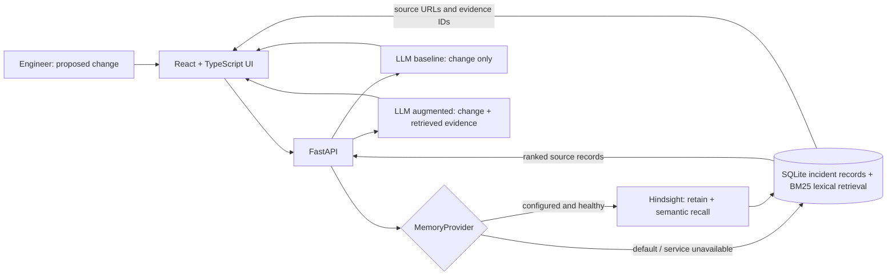

# ReleaseMind architecture

## Request flow

## Components

- **React UI:** accepts a proposed change and optional context; can upload an authorized JSON/CSV incident export; displays the baseline and memory-augmented assessments, retrieved records, sources, reported causes/remediation, safeguards, and the configured/actual memory provider.
- **FastAPI:** owns provider selection, ingestion, recall, paired LLM calls, citation validation, and source provenance. The browser never holds provider credentials.
- **SQLite local store:** canonical persistent source records and precise citation metadata. The default retriever uses BM25-style token ranking implemented locally; this fallback is lexical and should not be described as semantic embeddings.
- **Hindsight adapter (optional):** sends imported incident narratives to the configured Hindsight service and uses Hindsight recall. Original source records remain in local SQLite so retrieved Hindsight memories can be mapped to a source incident. Hindsight fact extraction can paraphrase source data, so show original source metadata and avoid presenting extracted facts as source quotations.
- **LLM:** receives the proposed change in both conditions. The baseline prompt contains no retrieved memory; the augmented prompt contains only selected records and source URLs. Returned evidence IDs are filtered against the actual retrieved set.
- **Source import:** JSON/CSV rows are normalized into a common incident record with an original URL. Rows missing a title, narrative, or HTTP(S) source URL are skipped. Records marked synthetic are excluded. The old synthetic examples file is not an input source.

## Data and rights boundary

The demo corpus is a 195-record snapshot of short summaries from the Postmortem Index; its publisher declares the index corpus GPL-3.0. The snapshot includes no full linked report bodies and retains each original source URL. Linked reports remain governed by their individual publishers' terms. The TU Delft VOID 348-report sample is excluded until exact package and source-report rights are verified. No source record is assumed to contain a commit, deployment ID, or causal link unless that information is present in that record. Missing cause/remediation remains missing. We do not infer a deployment → incident causal chain.

## LLM conditions and evidence rules

For one change input, ReleaseMind requests two assessments from the configured LLM model:

1. **Baseline:** proposed change and user-entered context only.
2. **Memory augmented:** same change/context plus top retrieved historical incident records.

The system prompt explicitly distinguishes reported historical facts from inference, prohibits incident prediction claims, and instructs the model to cite only supplied evidence IDs. The API additionally removes any citation ID that was not retrieved. An empty result set is passed as “no historical incident evidence was retrieved,” never replaced with generated examples.

## Configuration

| Variable | Purpose | Default |
|---|---|---|
| `OPENAI_API_KEY` | LLM baseline and augmented assessments (OpenAI-compatible provider key, including Groq) | Required for assessment |
| `LLM_BASE_URL` | Optional OpenAI-compatible API endpoint | Provider default |`r`n| `LLM_MODEL` | Configured provider model ID | `gpt-4o-mini` |
| `DATABASE_PATH` | Persistent SQLite path | `data/releasemind.sqlite3` |
| `RETRIEVAL_PROVIDER` | `local` or `hindsight` | `local` |
| `HINDSIGHT_BASE_URL` | Self-hosted or hosted Hindsight API URL | unset |
| `HINDSIGHT_API_KEY` | Hindsight bearer token (Cloud) | unset |
| `HINDSIGHT_BANK_ID` | Hindsight bank to retain/recall records in | `releasemind` |

For a self-hosted Hindsight server, its own environment must configure an LLM provider/key for retain/fact extraction, plus durable storage if persistence beyond the service's default local storage is desired. Hindsight Cloud uses its bearer API key and managed service. Hindsight isn't bundled or represented as available in the current workspace.

## Limits

- Local fallback is lexical BM25-style retrieval, not vector/embedding semantics.
- Hindsight is optional and requires a separately running/hosted service.
- The VOID license/access gate is unresolved; data must be supplied by an authorized user.
- The two LLM outputs can vary between calls. Their visual comparison is not a controlled empirical evaluation.
- No causal prediction, production outcome, or quantitative evaluation claim is supported by the current corpus.
